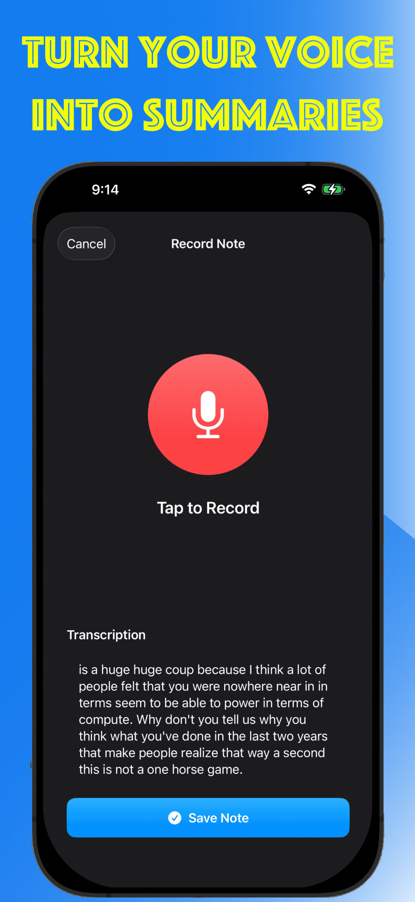
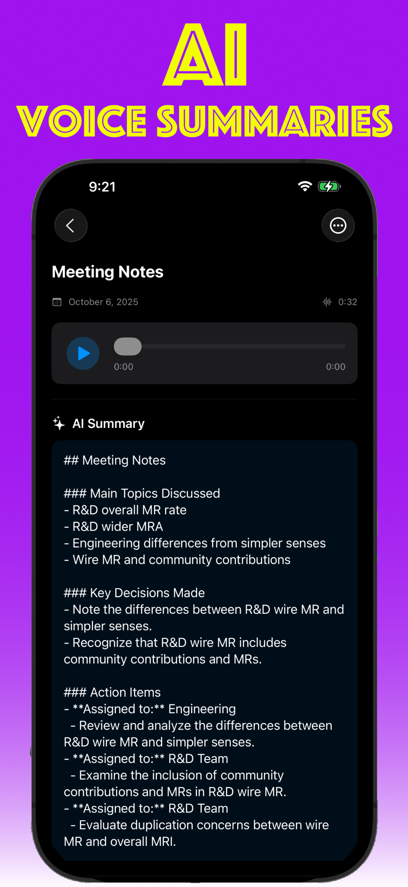

# VoiceSummary

**Capture more. Remember what matters.**

Record voice notes, transcribe speech into text, and generate AI summaries for meetings, lectures and everyday ideas.

[Visit the official website](https://elibooklover.github.io/VoiceSummary/)

## Features

- Record and review voice notes.
- Transcribe recordings into editable text.
- Generate AI summaries.
- Translate, re-transcribe, and export notes where available.

 

[Privacy Policy](https://elibooklover.github.io/VoiceSummary/privacy.html) · [Terms & Conditions](https://elibooklover.github.io/VoiceSummary/terms.html) · [Support](mailto:appdeveloperkim@gmail.com)
